# Iowa Vehicle Crash Data Analysis

**An Azure data pipeline and Power BI analysis of Iowa DOT crash records, built to find when, where and why serious crashes happen.**

Project for MIS 515: Big Data for Business, Iowa State University (Fall 2024), by DataVerse.

🌐 **[Live dashboard](https://codeind.github.io/Iowa-Vehicle-Crash-Data-Analysis/dashboard/)** · 📄 [Project report (PDF)](docs/Iowa_Crash_Analysis_Report.pdf) · 🎤 [Presentation](docs/Iowa_Crash_Analysis_Presentation.pptx)

---

## At a glance

| | |
|---|---|
| Sources | 4 public Iowa DOT datasets: crashes, people injured, drivers and vehicles, winter road conditions |
| Volume | 543,337 crash records, 181,000 injury records, 1,120,000 driver and vehicle records, 1,011 road-condition records |
| Pipeline | Azure Data Lake Storage → Azure Data Factory (join on Iowa DOT case number) → Microsoft Fabric Lakehouse → PySpark cleaning → Azure Data Factory copy → Azure SQL Database → Power BI |
| Analysis | SQL view of crash trends by hour, weekday, month and location; 4 Power BI visuals |
| Outcome | 4 recommendations for road agencies, law enforcement and public health |

---

## Live dashboard

**[Open the interactive dashboard](https://codeind.github.io/Iowa-Vehicle-Crash-Data-Analysis/dashboard/)** built from the complete public crash file (543,337 crashes, 2014–2023): crashes and deaths by year, a day-by-hour heat map, severity, monthly pattern, conditions and causes ranked by serious-injury rate, and all 99 counties.

[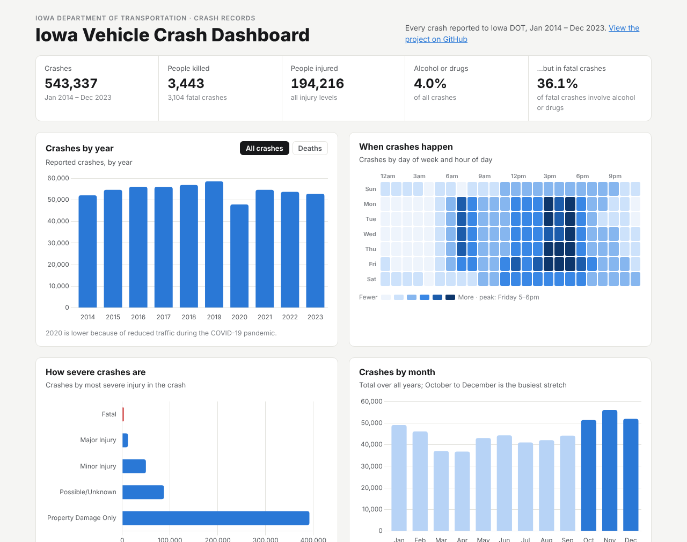](https://codeind.github.io/Iowa-Vehicle-Crash-Data-Analysis/dashboard/)

What the full dataset shows:
- **3,443 people were killed** in 3,104 fatal crashes from 2014 to 2023.
- Alcohol or drugs are involved in **4.0% of all crashes but 36.1% of fatal crashes**.
- On **dark, unlit roads** 6.1% of crashes are fatal or cause a major injury, more than double the daylight rate (2.7%).
- **Running off the road** is the most dangerous common cause: 7.5% of these crashes (right side) are fatal or cause a major injury.
- Crashes peak on **Friday between 5 and 6 pm**, and **October to December** is the busiest stretch of the year; **animals** are the most common major cause.

---

## Problem

Iowa has a high number of vehicle crashes that cause deaths, injuries and economic losses. The project analyzes historical crash data to find high-risk locations, times and conditions, and turns them into actions for:

- **Iowa DOT:** infrastructure and road safety measures
- **Law enforcement:** targeted patrols and enforcement
- **Public health organizations:** safe-driving campaigns
- **Insurers:** risk assessment

## Data

| Dataset | Records | Fields |
|---|---|---|
| [Vehicle Crashes in Iowa](https://data.iowa.gov/Crashes/Vehicle-Crashes-in-Iowa/tw78-ziwj) | 543,337 | 37 |
| [People Injured in Iowa Crashes](https://data.iowa.gov/Crashes/People-Injured-in-Iowa-Crashes/66tm-a8uq) | 181,000 | 18 |
| [Drivers and Vehicles Involved in Iowa Crashes](https://data.iowa.gov/Crashes/Drivers-and-Vehicles-Involved-in-Iowa-Crashes/vjnp-m8t4) | 1,120,000 | 40 |
| Iowa DOT Winter Road Conditions | 1,011 | 50 |

Source: Iowa Department of Transportation, published on the [Iowa Data portal](https://data.iowa.gov/). The raw files (about 970 MB) are not stored in this repository; download them from the links above.

## Architecture

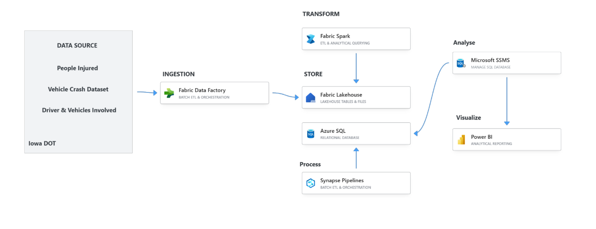

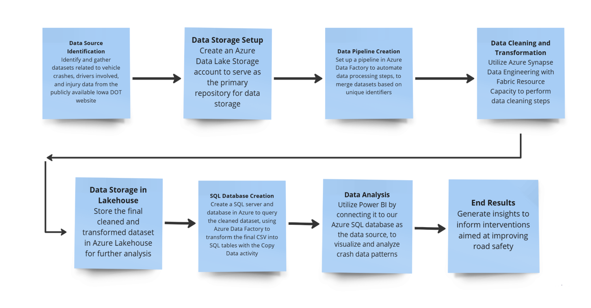

## Pipeline

1. **Storage.** The datasets were uploaded to containers in Azure Data Lake Storage.
2. **Join.** An Azure Data Factory data flow joined the crash, road-condition and injury records on the **Iowa DOT case number** and wrote the merged file back to the lake.

   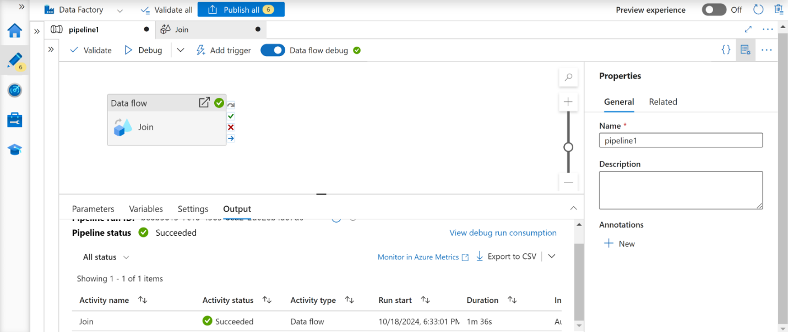

3. **Cleaning.** In a Microsoft Fabric workspace, a PySpark notebook dropped unneeded columns, set data types, filled nulls by type and combined the files into one cleaned dataset in the Fabric Lakehouse.

   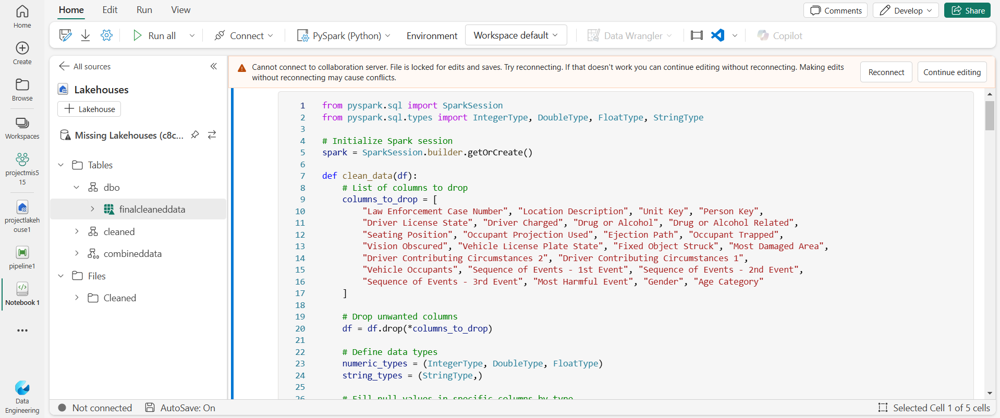
   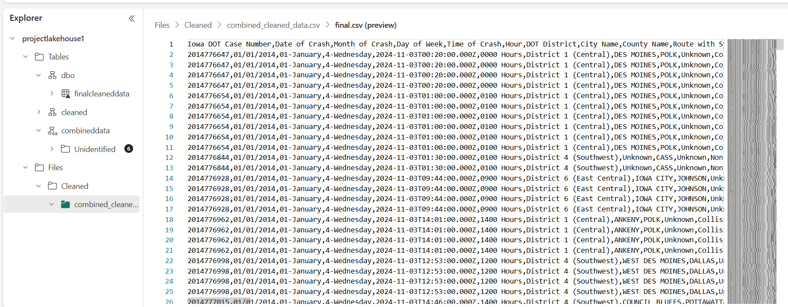

4. **Load.** A Data Factory Copy Data activity loaded the cleaned file from the Lakehouse into an Azure SQL Database table (`finalclean`).

   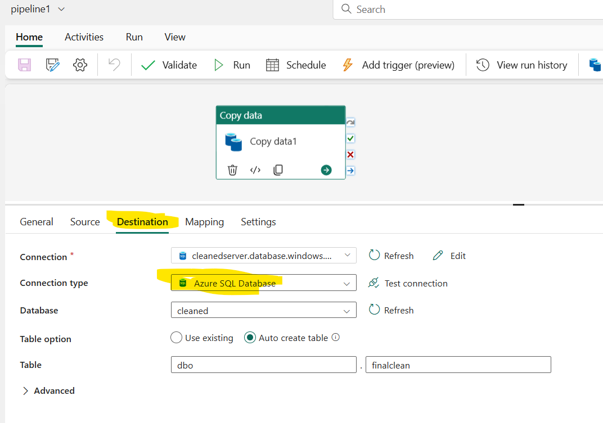

5. **SQL analysis.** In SQL Server Management Studio, a view aggregated crashes by hour, weekday, month, city, county and route. The query is in [`sql/crash_trends_view.sql`](sql/crash_trends_view.sql).

   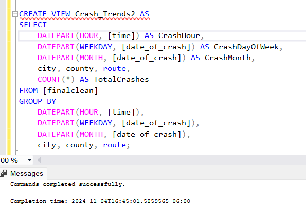

6. **Visualization.** Power BI connected to the Azure SQL database for the charts below.

## Power BI analysis

| | |
|---|---|
| **Crash severity by environmental condition.** Weather conditions are the most common environmental factor in crashes, well ahead of animals in the roadway, visual obstruction and glare.<br>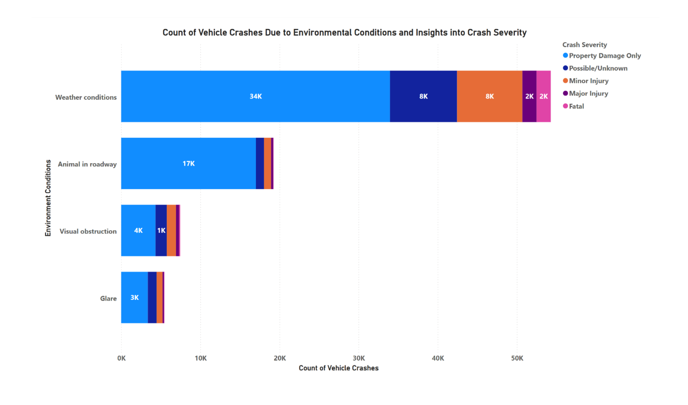 | **Crashes by day and hour.** Crashes concentrate on weekday afternoons; Friday has the most crashes (120,967), and 3 pm to 6 pm is the busiest window.<br>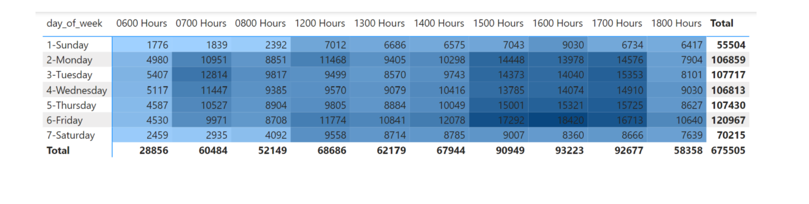 |
| **Top 5 vehicle makes in fatal crashes.** Ford, Chevrolet, unrecorded (NR), Freightliner and GMC appear most often. This reflects how common these makes are on the road as well as risk.<br>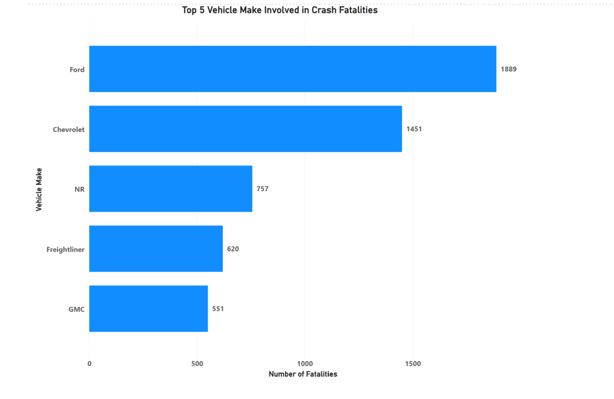 | **Fatalities by drug or alcohol result.** Statutory alcohol and drug/alcohol results account for the most fatalities among the impairment categories.<br>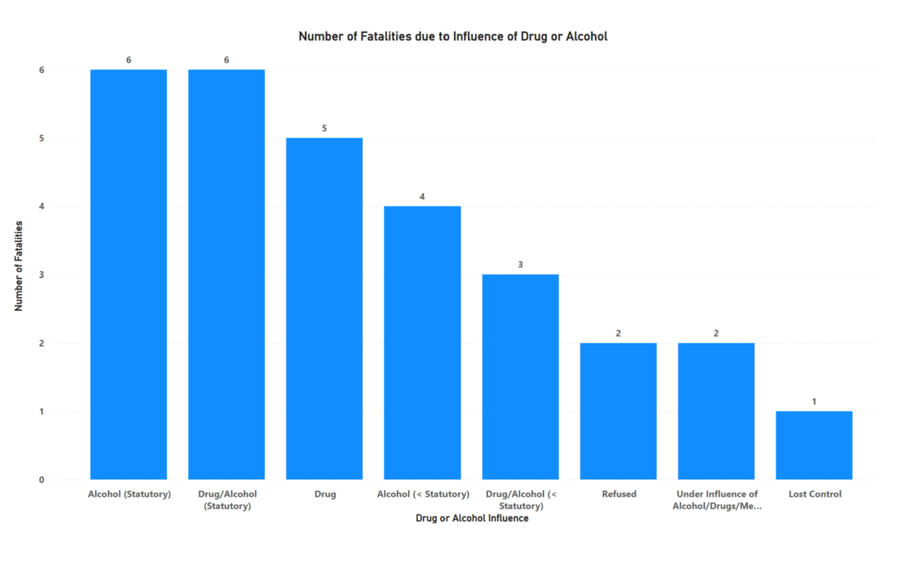 |

## Recommendations

1. **Road safety by condition:** prioritize lighting, signage, road markings and maintenance where adverse weather drives severe crashes.
2. **Targeted enforcement:** add patrols and speed and DUI enforcement during the peak crash hours.
3. **Vehicle safety:** work with manufacturers on features such as automatic braking and lane keeping for vehicles most often involved in fatal crashes.
4. **Impaired-driving campaigns:** community events, social media and business partnerships promoting sober driving and alternative transport.

## Limitations

- The cleaned SQL table holds **1,048,576 rows**, which is exactly the row limit of a Microsoft Excel worksheet. The merged file was likely cut off at that limit at some point, so the Power BI charts may not include every record. The live dashboard uses the complete public crash file instead.
- The merged dataset has one row per vehicle or person rather than per crash, so its counts (for example 675,505 in the heat map) are higher than the number of crashes.
- Counts by vehicle make reflect how many of each make are on the road, not only how safe they are.
- The PySpark notebook and Power BI file lived in the course's Azure and Fabric workspaces and are shown here through screenshots from the report.

## Repository structure

```
├── docs/
│   ├── Iowa_Crash_Analysis_Report.pdf        full project report
│   └── Iowa_Crash_Analysis_Presentation.pptx
├── images/
│   ├── azure_architecture.png, process_flow.png
│   ├── pipeline/                             Data Factory, PySpark, Lakehouse, Azure SQL, SSMS screenshots
│   └── analysis/                             the 4 Power BI visuals
├── sql/crash_trends_view.sql                 SQL view used for the trend analysis
└── dashboard/                                interactive web dashboard and its data builder
```

To rebuild the dashboard data, download the crash CSV from the link above and run `python dashboard/build_data.py path/to/Vehicle_Crashes_in_Iowa.csv` (needs pandas).
